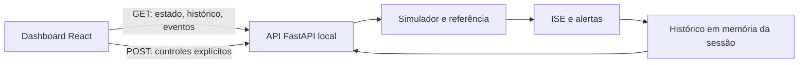

# prevLoss — dashboard local

Interface de Pedro para o backend 0.1.0, contrato 1. Uma bomba virtual, quatro medidas, cinco cenários. Não exige conta, nuvem, sensores ou internet durante a operação depois de instalada. O teste de isolamento externo está explicado em `ENTREGA_PEDRO.md`.

## Ambiente e instalação

Ambiente de referência: Windows, Node **24.12.0**, npm **11.6.2**, Python **3.13.15** e as versões exatas do `uv.lock`. O frontend registra Node em `.node-version` e `engines`, npm em `packageManager` e todas as dependências no `package-lock.json`.

Dependências instaladas: React/React DOM 19.3.1, Vite 8.3.7, TypeScript 6.0.3, Vitest 5.1.0, Recharts 3.10.1 e Playwright 1.65.0. A combinação foi instalada com Node 24.12.0. O Vitest instalado aceita Vite 6.4/7/8 e Node 22.12/24/26; o Vite aceita Node 20.19 ou 22.12 em diante. Não atualizar dependências automaticamente para reproduzir a entrega.

Na raiz do repositório, em PowerShell:

```powershell
uv python install 3.13.15
uv sync --locked
```

Na pasta `frontend`:

```powershell
node --version
npm --version
npm ci
```

A primeira instalação exige internet. Chrome instalado é usado pelos testes Playwright; a interface também pode ser aberta no Edge. As dependências, os gráficos e a fonte do sistema são locais.

## Apresentar com dois terminais

Terminal 1, na raiz do repositório:

```powershell
uv run --locked uvicorn backend.app.main:app --host 127.0.0.1 --port 8000 --workers 1
```

Terminal 2, na pasta `frontend`:

```powershell
npm run build
npm run preview
```

Abra **http://127.0.0.1:5173**. O build realiza a checagem TypeScript com `tsc -b` antes de gerar os arquivos. O preview serve esse build local; não o recompila. Depois de editar, execute `build` novamente. Para desenvolvimento com atualização automática, use `npm run dev` em vez de `preview`.

Tanto `dev` quanto `preview` usam `--host 127.0.0.1 --port 5173 --strictPort`. Se a porta estiver ocupada, o processo falhará claramente; não escolherá outra porta. Não execute os dois servidores de frontend ao mesmo tempo.

Não usar `--reload` ou múltiplos workers no backend durante a apresentação. Parar esse processo apaga sua sessão em memória. Para encerrar normalmente, use Ctrl+C nos terminais correspondentes.

## Operar

No primeiro acesso, um tutorial de seis passos apresenta a linha de base, os controles, as medições, o ISE, os alertas, os gráficos e o histórico. A conclusão ou o descarte fica registrado somente no navegador. Use **Como usar** no cabeçalho para reabrir o tutorial a qualquer momento.

1. Confirme **Sistema online**. Abrir ou recarregar a página apenas consulta o servidor.
2. Clique **Iniciar linha de base**. Aguarde 60 leituras válidas, aproximadamente um minuto.
3. A coleta concluída prepara uma execução Normal pausada. Clique **Iniciar monitoramento** explicitamente.
4. **Pausar** e **Retomar monitoramento** conservam os dados e a execução.
5. Trocar o **Cenário** encerra a execução anterior e prepara outra, pausada. Inicie quando estiver pronto.
6. **Nova execução** prepara novamente o cenário atual com seed 42 e preserva referência e histórico anterior.
7. Em **Histórico**, selecione uma execução. Os controles acima continuam operando a execução ativa; o seletor do histórico apenas consulta.
8. Para uma nova linha de base, selecione Normal, pause, abra **Informações**, clique **Refazer linha de base** e confirme. O histórico mantém suas referências anteriores.

Valores ausentes aparecem como “—”; zero é um valor válido. A classificação, as contribuições e os alertas vêm do backend. Pressão instável pode apresentar **ISE Normal com alerta ativo**. O valor de um alerta individual é a razão de desvio `r`; o alerta de oscilação de pressão apresenta dispersão em bar. Ambos descrevem o instante de abertura.

Os gráficos exibem os últimos 120 pontos, mas o histórico completo da execução permanece consultável. As lacunas não são conectadas. Datas são apresentadas no fuso `America/Bahia`; os gráficos usam segundos simulados. O simulador não para automaticamente em 120 leituras.

## Falhas e recuperação

| Situação | Procedimento |
| --- | --- |
| Sem conexão | Verificar o terminal da API, porta e endereço. Os últimos valores ficam identificados como antigos e comandos são suspensos. Há reconexão automática e botão de nova tentativa. |
| Contrato incompatível | Conferir backend/contrato 1 e a causa mostrada. Corrigir o servidor e clicar **Tentar sincronizar novamente**, ou aguardar a consulta automática. Só um estado compatível libera a operação. Não é necessário recarregar. |
| Comando sem confirmação | O cliente consulta o estado e não repete o POST automaticamente. Conferir o resultado antes de tentar de novo. |
| Falha de geração | O evento é exibido separadamente da pausa voluntária. Registrar erro, versão e execução para Emerson. |
| Nova sessão | O aviso de reinício explica a perda prevista dos registros em memória. A interface descarta caches anteriores. |
| Porta 5173 ocupada | Fechar o servidor de frontend anterior que você iniciou. Não encerrar processos desconhecidos. |
| Porta 8000 ocupada | Identificar o processo ou configurar uma porta alternativa na API e no frontend. |
| CORS | As origens padrão incluem `127.0.0.1:5173` e `localhost:5173`. Se mudar a origem, ajustar `PREVLOSS_CORS_ORIGINS` e carregar o arquivo do backend com `--env-file .env`. |

Para mudar a API, copie `frontend/.env.example` para `frontend/.env` e altere `VITE_API_BASE_URL`. Use apenas a origem, por exemplo `http://127.0.0.1:8001`, **sem `/api`**. No build, a variável é incorporada aos arquivos: gere novo build após alterá-la.

## Testes rápidos

Na raiz: `uv run --locked pytest -q`. Na pasta `frontend`:

```powershell
npm run lint
npm test
npm run build
npm run test:e2e
```

Os testes rápidos cobrem fixtures, respostas incompatíveis, concorrência, paginação, falhas de rede e interface. Eles não precisam aguardar a cadência real. O Playwright inicia o preview automaticamente se necessário.

Para inspecionar um exemplo visual, execute **apenas em desenvolvimento**: `http://127.0.0.1:5173/?fixture=critico`. Também estão disponíveis `estado-inicial`, `calibracao-24-de-60`, `normal`, `atencao`, `normal-com-alerta-individual`, `dado-ausente`, `dado-invalido`, `pausa` e `execucao-nova-pausada`. O banner identifica o modo, os comandos ficam desativados e os pontos auxiliares são exemplos sintéticos para apresentação visual. Essas fixtures não são evidência de cenário executado. O adaptador não integra o build de apresentação.

## Validação real e offline

Com as portas 8000 e 5173 livres e o build preparado, execute na pasta `frontend`:

```powershell
npm run test:real
```

Esse roteiro inicia seus próprios servidores, opera a interface pelo Chrome, executa a coleta real, 120 leituras de cada cenário, pausa/retomada, consulta histórica, nova execução, recalibração e reinício do servidor. Leva aproximadamente 12–15 minutos. Salva JSON, PNGs e gravação em `docs/evidencias/pedro/<data>/` e encerra somente os processos que iniciou. Não opera uma sessão que já esteja aberta. O reteste final aprovado está em `docs/evidencias/pedro/2026-11-12T02-26-43-166Z/` (carimbo UTC; execução local em 11/11/2026).

O Chrome isolado usa um proxy externo indisponível com exceção para loopback. Uma tentativa externa comprova o bloqueio antes de abrir o dashboard. Toda a demonstração roda nesse contexto; qualquer requisição externa da aplicação reprova o teste. Os adaptadores de rede do Windows não são alterados. Isso comprova a independência de recursos externos da aplicação; não é uma alegação de teste com Wi-Fi desligado fisicamente.

Para repetir manualmente a condição de computador desconectado, instale tudo e gere o build, desligue a conexão externa, inicie os dois terminais e percorra Normal e Múltiplos desvios. Não abra o Swagger. Registre data, versões, execução e resultado no modelo de evidência.

## Roteiro de apresentação

1. Explicar que os dados representam uma bomba virtual.
2. Preparar a referência antes da apresentação ou explicar sua coleta de um minuto.
3. Mostrar Normal: quatro variáveis, ISE e ausência de alertas.
4. Trocar para Múltiplos desvios, iniciar e acompanhar Atenção e Crítico.
5. Explicar contribuições e alertas individuais; não afirmar diagnóstico ou previsão real de falha.
6. Pausar, abrir Histórico e comparar as execuções sem misturá-las.
7. Se usar a gravação reserva, identificar explicitamente que é uma gravação de uma execução anterior.

A gravação curta MP4 gerada na entrega já contém a faixa **“Gravação reserva | Ambiente simulado”** e acompanha o repositório. A gravação integral WebM é um artefato local de evidência e não entra no Git por causa do tamanho; copie-a separadamente quando quiser conservar todo o fluxo.


